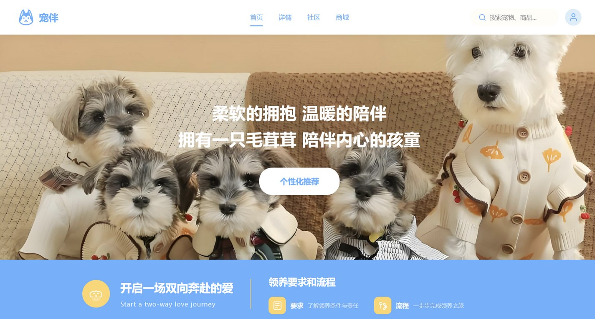

# 宠伴 PetPal · 宠物领养平台

> 柔软的拥抱，温暖的陪伴。

**宠物领养 × 社区科普 × 宠物商城的一体化静态网站**  
毕业设计作品 · 使用 Claude Code 辅助开发

[](https://developer.mozilla.org/zh-CN/docs/Web/HTML)
[](https://developer.mozilla.org/zh-CN/docs/Web/CSS)
[](https://developer.mozilla.org/zh-CN/docs/Web/JavaScript)
[](https://claude.com/claude-code)
[](#开发说明)

**[在线预览](https://morningluu.github.io/petpal-website/)** · **[源码仓库](https://github.com/morningluu/petpal-website)**



---

## 项目简介

「宠伴 PetPal」是一个以“领养代替购买”为核心理念的宠物生活平台。网站把**宠物领养、养宠科普、社区交流与宠物用品商城**放在同一条体验路径里：用户可以先了解领养条件和流程，再浏览待领养宠物，随后进入详情页查看性格与健康信息，也可以在社区获取养宠知识，或到商城选购用品。

视觉上采用奶油白、天空蓝与暖黄色组成低饱和配色，用大圆角卡片、柔和阴影和真实宠物影像，建立亲和、温暖、可信赖的品牌感受。

## 页面与功能

| 页面 | 文件 | 主要内容 |
| --- | --- | --- |
| 首页 | `index.html` | 全屏宠物主视觉、平台推荐、领养要求与流程、热门宠物滑动卡片、热门文章折叠阅读、热门搜索 |
| 宠物详情 | `detail.html` | 宠物图片轮播、犬/猫/鸟/仓鼠分类切换、性格与健康信息、领养行动按钮 |
| 宠物社区 | `community.html` | 宠物百科轮播、掌上医生、智能问答、养宠知识卡片 |
| 宠物商城 | `shop.html` | 商品分类筛选、商品卡、加购与数量调整、购物车合计、清空与下单提示 |

### 核心交互

- **主视觉与内容轮播**：首页 banner 与热门宠物轨道支持自动播放、前后切换和圆点跳转。
- **分类筛选**：商城与热门宠物区可按类别筛选，切换过程带过渡动画。
- **文章折叠阅读**：热门文章支持“查看详情 / 收起”，在有限首屏内承载长内容。
- **购物车本地持久化**：基于 `localStorage` 保存商品数量，刷新页面后仍能恢复；支持增减、删除、清空、金额统计和下单反馈。
- **搜索与问答**：顶部搜索框、社区提问区均提供前端交互反馈。
- **滚动显现**：使用 `IntersectionObserver` 配合 CSS 动画，让内容在进入视口时自然出现。
- **响应式布局**：8 组媒体查询覆盖桌面、平板与手机，移动端收起导航并改为单列信息流。

## 设计说明

- **色彩**：`#65B1FF` 天空蓝作为行动色，`#FFD56A` 暖黄作为点缀，`#FFFDF8` 奶油白作为页面底色。
- **形态**：20px 大圆角卡片、轻量描边与柔和投影，避免生硬的“信息后台”感。
- **影像**：以真实宠物照片作为主要情绪载体，文字层使用半透明遮罩保证可读性。
- **动效**：`fadeInUp` 入场、购物车弹跳、卡片悬浮与轮播过渡，节奏轻快但不过度。
- **信息层级**：从“情感主张 → 领养流程 → 真实宠物 → 科普内容 → 商城”逐步推进。

## 技术栈

- 原生 **HTML5**：语义化页面结构，四个页面共享导航与页脚。
- 原生 **CSS3**：CSS 自定义属性、Flexbox、Grid、媒体查询、关键帧动画。
- 原生 **JavaScript (ES6+)**：轮播、筛选、搜索、折叠面板、滚动监听、购物车状态管理。
- **无框架、无构建步骤、无第三方运行时依赖**，克隆后即可运行。

## 目录结构

```text
petpal-website/
├── index.html              # 首页
├── detail.html             # 宠物详情
├── community.html          # 宠物社区
├── shop.html               # 宠物商城
├── css/
│   ├── style.css           # 全站样式与响应式规则
│   └── petpal-theme.css    # 主题变量补充
├── js/
│   └── main.js             # 轮播、筛选、购物车等交互
├── images/                 # 宠物与内容图片
├── preview.jpg             # README 预览图
└── README.md
```

## 本地运行

项目是纯静态站点，不需要安装依赖。

**方式一：直接打开**

双击 `index.html` 即可浏览。部分浏览器对本地文件的脚本限制较严格，推荐使用方式二。

**方式二：本地服务器**

```bash
# 在项目根目录执行
python -m http.server 8000
```

然后访问 <http://localhost:8000>。

## 开发说明

- **项目性质**：毕业设计 / 静态网站设计与实现
- **开发方式**：页面结构、样式与交互使用 **Claude Code** 辅助完成，由作者进行内容组织、视觉调整与最终验收
- **代码特征**：四个页面共用一套设计系统；交互逻辑集中在 `js/main.js`，便于讲解与维护
- **浏览器支持**：Chrome、Edge、Firefox、Safari 等现代浏览器

## 素材与声明

页面中的品牌名称、宠物信息、商品与联系方式均为**毕业设计演示内容**，不构成真实交易或服务承诺。图片素材仅用于学习与作品展示，版权归原作者所有；如涉及版权问题，请联系仓库作者处理。

## 作者

[@morningluu](https://github.com/morningluu)

如果这个项目对你的课程设计或前端练习有帮助，欢迎点一个 Star。
